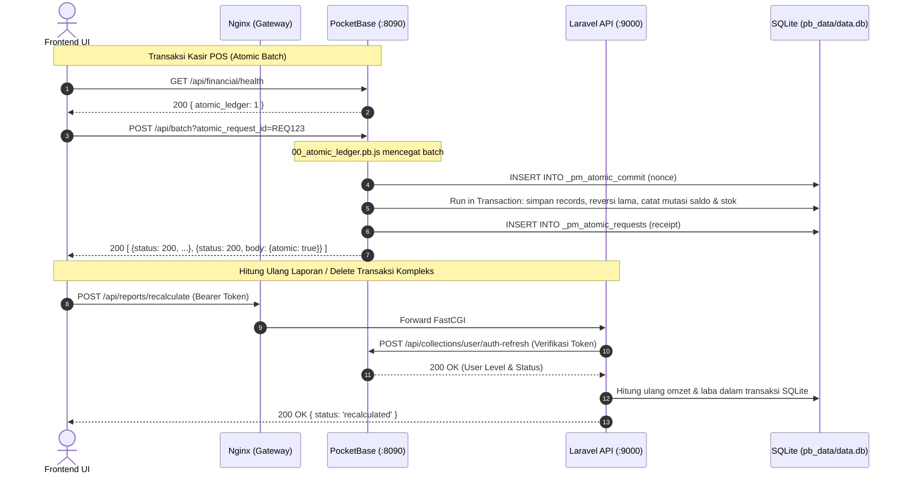

# API Surface & Integrasi

Arsitektur API Prima Motor POS terbagi dua backend yang berbagi database SQLite sama:
1. **PocketBase REST API & Hooks** (`PB_PUBLIC_URL`, default host port `8090`).
2. **Laravel REST API** (`API_PUBLIC_URL`, diproxy via Nginx di `API_HOST_PORT`, default `8000`).

---

## 1. PocketBase Endpoints & Hooks Router

### A. Endpoint Standar PocketBase (`/api/collections/...`)
* Auth: `POST /api/collections/user/auth-with-password`
* Refresh: `POST /api/collections/user/auth-refresh`
* Batch Transaction: `POST /api/batch?atomic_request_id={id}`
* CRUD Records:
  * `/api/collections/menu/records` (Transaksi induk kasir)
  * `/api/collections/log_stock/records` (Mutasi stok barang)
  * `/api/collections/cashflow/records` (Mutasi kas/bank)
  * `/api/collections/ongkos/records` (Komisi jasa servis mekanik)
  * `/api/collections/bon/records` (Piutang pinjaman staf/pelanggan)
  * `/api/collections/gaji/records` (Slip gaji bulanan staf)
  * `/api/collections/produk/records` (Master katalog & harga)
  * `/api/collections/dropdown/records` (Akun kas/bank & master enum)
  * `/api/collections/report/records` (Snapshot harian omzet & laba)

### B. Custom Router Hook PocketBase (`Backend/pb_hooks/`)
| Method | Path | File Hook | Deskripsi & Validasi |
| :--- | :--- | :--- | :--- |
| `GET` | `/api/financial/health` | `00_atomic_ledger.pb.js` | Cek status migrasi atomic ledger: returns `{ atomic_ledger: 1 }` (200) atau 503 jika tabel `_pm_atomic_changes` belum siap. |
| `POST` | `/api/financial/requests/{id}/resolve` | `00_atomic_ledger.pb.js` | Resolusi status receipt transaksi yang terputus koneksi. Jika belum commit, ditandai `cancelled`. Memakai SQLite write lock. |
| `POST` | `/api/permissions/delete` | `delete_access.pb.js` | Pemeriksaan izin hapus read-only batch (maks 200 record). Mengecek `viewRule`, `deleteRule`, izin akun kas terkait (`visibilitas`, `enum_1`), dan proteksi stok produk. |

---

## 2. Laravel REST API (`Backend/routes/api.php`)

Seluruh route Laravel disaring oleh middleware `App\Http\Middleware\AuthenticatePocketBase`.

### A. Autentikasi & User
* `GET /api/user` — Mengembalikan payload record user dari PocketBase session token.

### B. Master Data (`routes/api/master.php`)
* `apiResource('produks', ProdukController::class)` — CRUD inventaris produk. Menolak DELETE jika user bukan Level 1.
* `apiResource('menus', MenuController::class)` — CRUD data menu/transaksi.
* `apiResource('dropdowns', DropdownController::class)` — CRUD kategori, merk, unit, akun kas. Perubahan selain `GET` hanya boleh Level 1.

### C. Keuangan (`routes/api/finance.php`)
* `apiResource('bons', BonController::class)` — Akses dibatasi level 1–6 (level lain diarahkan ke slip gaji akun).
* `apiResource('cashflows', CashflowController::class)` — Mutasi buku kas.
* `apiResource('ongkos', OngkosController::class)` — Biaya ongkos jasa servis.

### D. Inventaris (`routes/api/inventory.php`)
* `apiResource('log-stocks', LogStockController::class)` — Mutasi stok masuk/keluar. Mendukung flag eksplisit `stok_override: true` untuk re-anchor histori stok tanpa manipulasi log palsu.

### E. Laporan & Akuntansi (`routes/api/reports.php`)
* `GET /api/reports` — Daftar agregasi laporan keuangan (Level 1–6 saja).
* `GET /api/reports/{id}` — Detail laporan spesifik.
* `GET /api/reports/today` — Agregasi laporan hari ini.
* `POST /api/reports/recalculate` — Memicu kalkulasi ulang omzet, HPP, piutang, dan laba-rugi untuk tanggal tertentu (`{ date: "YYYY-MM-DD" }`).

### F. Transaksi Atomik & Webhook (`routes/api/webhooks.php`)
* `DELETE /api/transactions/{collection}/{id}` (`TransactionDeleteController@destroy`):
  * Menghapus transaksi kasir/induk dan seluruh relasi turunannya (`log_stock`, `cashflow`, `ongkos`, `bon`, `gaji`).
  * Membalik saldo akun kas dan stok barang secara atomik di dalam SQLite transaction Laravel.
  * Bersifat retry-safe (idempoten).
* `POST /api/webhook/{collection}/{event}/{id}` (`WebhookController@handle`) — Listener mutasi instan dari PocketBase.
* `POST /api/webhooks/batch` (`WebhookController@batch`) — Listener batch best-effort dengan deduplikasi via tabel `webhook_marks`.

---

## 3. Diagram Alur Permintaan API

---

Terkait: [[Architecture]], [[Data Source]], [[Engine - Atomic Ledger & Idempotensi]], [[Domain - POS & Kasir]]
