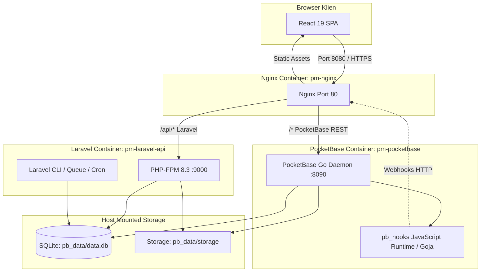

# Architecture — Sistem & Infrastruktur

## 1. Topologi Sistem
Prima Motor POS mengadopsi arsitektur **Shared-Database Hybrid Monolith**. Dua runtime backend (PocketBase dalam Go dan Laravel dalam PHP-FPM) membaca dan menulis ke satu file database SQLite yang sama (`pb_data/data.db`).

---

## 2. Karakteristik Komponen

### A. Frontend (`Frontend/`)
* **Framework:** React 19 + Vite 8 + TypeScript.
* **Styling & UI:** Tailwind CSS, Lucide Icons, Recharts, Custom Glassmorphism.
* **Peran:** UI POS, Manajemen Produk, Kasir, Penggajian, Pelaporan, Autentikasi.
* **Routing:** React Router v7 dengan lazy loading chunk per halaman dan auto-refresh versi (`/version.json`).

### B. PocketBase (`pm-pocketbase`)
* **Engine:** Go compiled binary (`nxtgencat/pocketbase:latest`).
* **Port Internal:** `8090`.
* **Peran:**
  * Pusat otentikasi user & token JWT.
  * Penyedia REST API CRUD instan untuk semua koleksi bisnis.
  * Atomic Ledger Hooks (`00_atomic_ledger.pb.js`) untuk menjamin konsistensi ACID saldo kas dan stok.
  * File storage untuk upload foto produk, nota bon, dan avatar staf.

### C. Laravel API (`pm-laravel-api`)
* **Engine:** PHP 8.3-FPM + Nginx fastcgi.
* **Peran:**
  * Pengecekan izin hapus terpusat (`POST /api/permissions/delete`).
  * Endpoint rekalkulasi laporan laba/rugi harian (`POST /api/reports/recalculate`).
  * Webhook listener untuk sinkronisasi async mutasi ledger.
  * Command CLI & Scheduler: `report:create-daily`, `report:cleanup-holiday`, `reconcile:transactions`.
  * Verifikasi sesi klien melalui token PocketBase via middleware `AuthenticatePocketBase`.

### D. Nginx Gateway (`pm-nginx`)
* **Peran:** Single entry point pada port host `WEB_HOST_PORT` dan `API_HOST_PORT`.
* Menyajikan file static React dari `/html/frontend` dan mengarahkan rute API ke upstream yang sesuai.

---

## 3. Shared Database & Dual Execution Pattern
Kunci stabilitas arsitektur ini:
1. **Satu File Database:** PocketBase dan Laravel sama-sama membuka `pb_data/data.db`.
2. **Mode WAL (Write-Ahead Logging):** SQLite diaktifkan dalam mode WAL untuk mengizinkan banyak pembaca konkruen bersamaan dengan satu penulis.
3. **Dual Logic Synchronization:**
   * Alur utama berjalan di hook PocketBase (`pb_hooks/lib/atomic_ledger.js`).
   * Alur rekonsiliasi dan laporan periodik dijalankan di Laravel (`CashflowLedger.php` dan `ReportService.php`).
   * Keduanya berbagi formula matematika yang sama persis (lihat [[Engine - Atomic Ledger & Idempotensi]]).

---

Terkait: [[Data Source]], [[Database & Schema]], [[API Surface & Integrasi]], [[Engine - Atomic Ledger & Idempotensi]]
