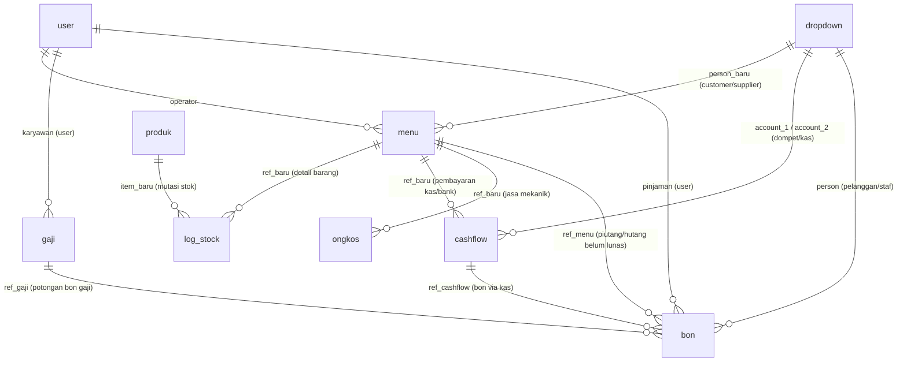

# Database & Schema

Seluruh aplikasi bertumpu pada satu file database SQLite: `pb_data/data.db` (bawaan: `Backend/pb_data/data.db`).

---

## 1. Diagram Relasi Entitas (ERD)

---

## 2. Struktur Tabel Bisnis

### A. `menu` (Transaksi Penjualan / Pembelian / Servis)
* `id` (`TEXT(15)` PK): ID unik alfanumerik PocketBase.
* `jenis` (`TEXT`): Jenis transaksi (`Penjualan`, `Servis Motor`, `Pembelian`, `Pengeluaran`, dll).
* `status` (`TEXT`): Status pembayaran (`lunas`, `belum`).
* `total` (`REAL`): Total nilai transaksi kotor / netto.
* `dibayar` (`REAL`): Total nominal uang yang telah diterima / dibayarkan saat transaksi dibuat.
* `person_baru` (`TEXT` FK): Relasi ke tabel `dropdown` (kontak pelanggan/supplier).
* `person` (`TEXT`): ID kontak legacy (fallback kompatibilitas).
* `operator` (`TEXT`): Username kasir yang melayani.
* `payment` (`TEXT`): Metode pembayaran ringkas (`Cash`, `Transfer`, `Split`, `Tempo`).
* `date_lunas` (`TEXT`): Tanggal pelunasan jika berstatus tempo.
* `cashback` (`REAL`): Nilai diskon potongan atau cashback tunai.
* `admin` (`REAL`): Biaya admin marketplace atau charge kartu kredit.
* `qty` (`REAL`): Total akumulasi jumlah unit barang.
* `text` (`TEXT`): Catatan transaksi (nomor polisi kendaraan, nama marketplace, nota supplier, dll).
* `file` (`JSON`): Array lampiran nota fisik / foto bukti transaksi.
* `id_lama` (`TEXT`): Kode nota invoice lama (misal: `PJ-2024-001`).

### B. `produk` (Katalog Inventaris & Harga Multi-Tier)
* `id` (`TEXT(15)` PK): ID produk.
* `nama` (`TEXT`): Nama produk / sparepart.
* `kode` (`TEXT`): Kode barcode / SKU produk.
* `id_lama` (`TEXT`): ID barang di sistem lama (digunakan untuk rekonsiliasi dan verifikasi keunikan).
* `kategori`, `merk`, `unit` (`TEXT` FK): Relasi ke master `dropdown`.
* `beli` (`REAL`): Harga beli / modal dasar (HPP). Diperbarui otomatis saat ada stok masuk (`log_stock` in).
* `sell_1` s/d `sell_6` (`REAL`): Matriks harga jual bertingkat (retail toko, grosir, langganan bengkel, online, dsb).
* `min_1` s/d `min_3` (`INTEGER`): Kuantum kuantitas minimum untuk mengaktifkan tier harga grosir.
* `stok_1` (`REAL`): Stok di Gudang Utama.
* `stok_2` (`REAL`): Stok di Toko / Display Depan.
* `stok_3` (`REAL`): **Stok Terproteksi Total**. Hanya boleh bertambah/berkurang lewat `log_stock`, atau via API berpenanda `stok_override: true`.
* `img` (`JSON`): Array gambar produk dan lampiran file video (.mp4/.mov).

### C. `log_stock` (Histori Mutasi Stok)
* `id` (`TEXT(15)` PK): ID mutasi.
* `item_baru` (`TEXT` FK): Relasi ke `produk.id`.
* `qty` (`INTEGER`): Jumlah unit fisik yang bermutasi.
* `boolean` (`TEXT`): Arah mutasi (`in` = masuk/beli/retur; `out` = keluar/jual/penyesuaian).
* `price_1` (`REAL`): Harga transaksi satuan.
* `price_2` (`REAL`): Nilai HPP / modal satuan pada saat mutasi terjadi.
* `ref_baru` (`TEXT` FK): Relasi ke induk `menu.id`.
* `operator` (`TEXT`): Username staf/kasir yang mengubah.
* `stok_awal` (`REAL`): **Snapshot stok** sebelum mutasi ini berlaku.
* `stok_akhir` (`REAL`): **Snapshot stok** setelah mutasi ini selesai diaplikasikan.

### D. `cashflow` (Buku Kas & Rekening Bank)
* `id` (`TEXT(15)` PK): ID mutasi kas.
* `mutasi` (`TEXT`): `in` (kas masuk/debet) atau `out` (kas keluar/kredit).
* `jenis` (`TEXT`): Kategori cashflow (merujuk ke master `dropdown` jenis cashflow, atau keyword sistem: `bon`, `bonkaryawan`, `transfer`, `gaji`).
* `nominal` (`REAL`): Nilai mutasi uang dalam rupiah.
* `account_1` (`TEXT` FK): Akun kas asal (sumber dana) -> relasi `dropdown.id`.
* `account_2` (`TEXT` FK): Akun kas tujuan (jika jenis transfer) atau user karyawan (jika bon karyawan).
* `person` (`TEXT` FK): Kontak pelanggan/supplier terkait -> relasi `dropdown.id`.
* `ref_baru` (`TEXT` FK): Relasi ke induk `menu.id`.
* `saldo_awal` (`REAL`): **Snapshot saldo dompet** sebelum pencatatan transaksi.
* `saldo_akhir` (`REAL`): **Snapshot saldo dompet** sesudah pencatatan transaksi.

### E. `dropdown` (Master Data & Akun Kas/Bank)
* `id` (`TEXT(15)` PK): ID dropdown.
* `jenis` (`TEXT`): Sub-kategori master. Frontend memfilter dengan pola `~` (mengandung kata), mis. `jenis ~ "customer"`, `jenis ~ "supplier"`, `jenis ~ "cashflow account"`. Daftar nilai lengkap belum diverifikasi; cek data nyata / migrasi seed.
* `kategori` (`TEXT`): Grup master, mis. `cashflow`, `person`, dan kategori produk. Untuk person, nilai `jenis` pada tabel `person` UI berbentuk `Customer` / `Supplier` (huruf kapital awal).
* `text_1` (`TEXT`): Label nama item (contoh: "Kasir Toko Utama", "BCA Operasional").
* `number_1` (`REAL`): **Saldo Berjalan Terproteksi** (untuk akun kas/bank) atau **Total Piutang Berjalan** (untuk kontak pelanggan/staf).
* `visibilitas` (`TEXT`): Daftar level pengguna yang boleh melihat akun ini (misal: "1,2,3,4").
* `enum_1` (`TEXT`): Daftar username staf yang memiliki izin hapus transaksi pada akun kas ini (whitelist).

### F. `bon` (Buku Pinjaman & Piutang)
* `id` (`TEXT(15)` PK): ID bon.
* `jenis` (`TEXT`): `out` (pemberian pinjaman/piutang baru) atau `in` (pembayaran/pelunasan bon).
* `nominal` (`REAL`): Nilai bon.
* `person` (`TEXT` FK): Relasi ke `dropdown.id` (kontak debitur).
* `user` (`TEXT` FK): Relasi ke `user.id` (jika debitur adalah karyawan bengkel).
* `ref_cashflow` (`TEXT` FK): Relasi ke baris cashflow saat uang kas keluar/masuk.
* `ref_menu` (`TEXT` FK): Relasi ke transaksi penjualan saat ada nota tempo.

### G. `gaji` (Slip Penggajian Karyawan)
* `id` (`TEXT(15)` PK): ID slip gaji.
* `user` (`TEXT` FK): Relasi ke karyawan pemilik slip gaji.
* `nominal` (`REAL`): Gaji bersih (take-home pay).
* `gaji_pokok`, `tunjangan`, `uang_makan` (`REAL`): Komponen penghasilan.
* `potongan_bon`, `potongan_alfa`, `potongan_bpjs` (`REAL`): Komponen pemotongan.
* Akses read: Dibatasi ketat di tingkat rule PocketBase (hanya pemilik data atau Level 1).

### H. `report` (Snapshot Agregasi Harian)
* `id` (`TEXT(15)` PK): ID laporan.
* `created_at` (`TEXT`): Tanggal kalender Jakarta (`YYYY-MM-DD`).
* `omset_toko`, `omset_minuman`, `omset_servis` (`REAL`): Akumulasi penjualan per segmen.
* `laba_penjualan`, `laba_minuman`, `laba_service` (`REAL`): Akumulasi laba kotor.
* `operasional_toko`, `pemasukan_lain`, `pengeluaran_lain` (`REAL`): Biaya operasional.
* `hutang`, `piutang` (`REAL`): Posisi sisa kredit berjalan hari tersebut.

---

## 3. Tabel Sistem & Atomic Ledger

### `_pm_atomic_changes` (Journal Perubahan Transaksi)
* `id` (`TEXT(24)` PK): ID baris log.
* `batch_id` (`TEXT`): ID batch transaksi dari token random string.
* `collection_name` (`TEXT`): Nama tabel yang termutasi (`menu`, `cashflow`, dll).
* `record_id` (`TEXT`): ID baris yang dibuat/diubah/dihapus.
* `event` (`TEXT`): Tipe aksi (`created`, `updated`, `deleted`).
* `old_data` (`TEXT JSON`): Snapshot kondisi record sebelum mutasi dijalankan.
* `new_data` (`TEXT JSON`): Snapshot kondisi record setelah mutasi selesai.

### `_pm_atomic_requests` (Tabel Idempotensi Receipt)
* `id` (`TEXT` PK): Format `{user_id}:{request_id}`.
* `response_json` (`TEXT JSON`): Menyimpan payload respons sukses (`status: 'committed'`) atau pembatalan (`status: 'cancelled'`).

### `_pm_atomic_commit` (Koleksi Sinyal Commit Batch)
* Koleksi buatan PocketBase yang diisi saat batch hendak mengakhiri eksekusinya via field `nonce`.

---

Terkait: [[Architecture]], [[Domain - POS & Kasir]], [[Engine - Atomic Ledger & Idempotensi]]
