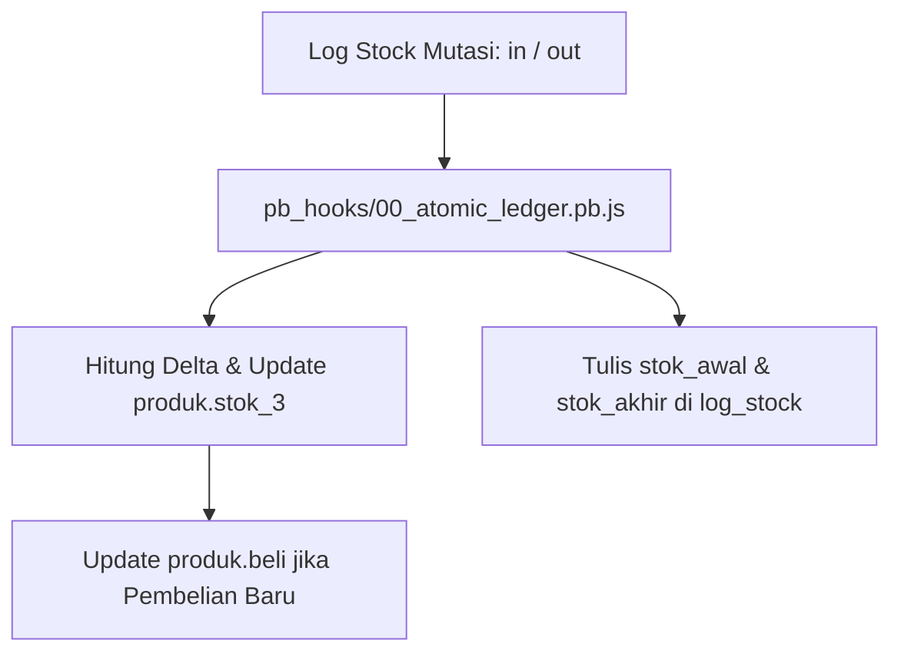

# Domain — Inventaris & Produk

Modul produk (`Frontend/src/pages/produk.tsx`) menangani master katalog barang, pengendalian kuantitas stok fisik di multi-gudang, dan kalkulasi HPP.

---

## 1. Lokasi & Penyimpanan Stok
Produk memiliki 3 kolom kuantitas stok:
* `stok_1` — Stok Gudang Cadangan / Belakang.
* `stok_2` — Stok Display Depan / Etalase Toko.
* `stok_3` — **Stok Terproteksi Total**.
  * Kolom ini adalah agregasi mutasi legal seluruh sistem.
  * **Larangan Keras:** Dilarang mengedit `stok_3` secara langsung lewat form input biasa.
  * Perubahan normal hanya terjadi via pembuatan baris baru di tabel `log_stock`.
  * **Frontend Dilarang Menghitung Snapshot:** Frontend tidak lagi menghitung `stok_awal` atau `stok_akhir` pada payload `log_stock`. Nilai riwayat dihitung murni di backend via `anchorStock` menggunakan window function SQLite.

---

## 2. Mekanisme `stok_override` & Re-anchoring
Jika terjadi selisih stok fisik akibat opname atau koreksi admin:
* Pembaruan `stok_3` langsung dari UI/API akan ditolak oleh hook PocketBase dan collection rule, **kecuali** menyertakan parameter eksplisit `{ stok_override: true }`.
* Saat `stok_override: true` diterapkan:
  1. Nilai baru `stok_3` wajib integer $\ge 0$.
  2. Sistem hook PocketBase (`anchorStock` / `reanchorStock`) akan **menghitung ulang dan menyelaraskan (re-anchor)** seluruh rantai riwayat `stok_awal` dan `stok_akhir` pada entri `log_stock` masa lalu yang relevan terhadap saldo akhir baru.
  3. Non-admin tanpa flag `stok_override: true` akan dikembalikan ke nilai DB semula oleh hook `00_atomic_ledger.pb.js`.

---

## 3. Matriks Harga Multi-Tier
Setiap suku cadang memiliki hingga 6 tier harga jual dan 3 batas minimum kuantum:
| Field Harga | Field Kuantum Minimum | Deskripsi Penggunaan |
| :--- | :--- | :--- |
| `sell_1` | 1 unit | Harga retail standar toko offline |
| `sell_2` | `min_1` unit | Harga grosir langganan bengkel kecil |
| `sell_3` | `min_2` unit | Harga partai / reseller besar |
| `sell_4` | `min_3` unit | Harga langganan distributor / corporate |
| `sell_5` | Bebas | Harga marketplace online (Shopee/Tokopedia) |
| `sell_6` | Bebas | Harga diskon khusus / promo akhir pekan |

---

## 4. Normalisasi Kode SKU & Deteksi Konflik (`src/lib/products.ts`)
* `normalizeProductCode(code)`:
  * Menghapus awalan nol (leading zeros) pada kode yang murni angka (misal: `000142` -> `142`).
  * Mempertahankan kode alfanumerik persis apa adanya (misal: `BRG-0021A`).
* `displayProductCode(code)`:
  * Memformat angka murni menjadi 5 digit padding nol untuk kemudahan membaca label barcode fisik toko.
* `isProductCodeConflict()`:
  * Memeriksa benturan duplikasi kode barcode terhadap database lokal maupun kesalahan duplikasi field `id_lama` pada PocketBase (`validation_not_unique`).

---

## 5. Perlindungan Hapus Produk (Product Deletion Guard)
Sebuah produk **tidak dapat dihapus** jika:
1. Masih memiliki nilai stok fisik berjalan (`stok_3 > 0`).
2. Pernah memiliki riwayat transaksi mutasi stok di tabel `log_stock`, meskipun stok saat ini 0. (Hal ini demi menjaga integritas laporan historis laba rugi dan audit masa lalu).

---

Terkait: [[Database & Schema]], [[Domain - POS & Kasir]], [[Engine - Atomic Ledger & Idempotensi]]
