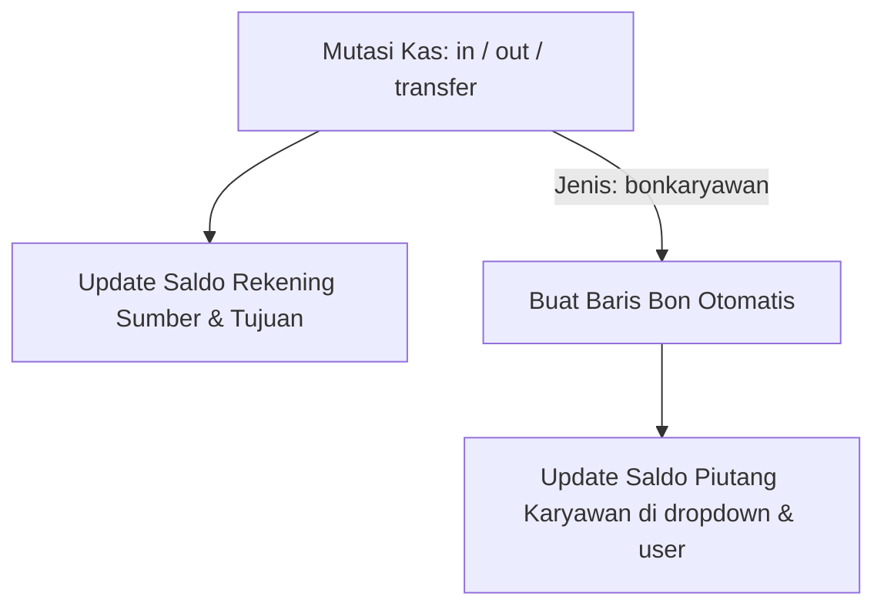

# Domain — Keuangan & Cashflow

Buku kas harian (`Frontend/src/pages/cashflow.tsx`) mencatat seluruh mutasi uang tunai, transfer bank, dan pinjaman (bon) dalam satu ledger terpadu.

---

## 1. Jenis Mutasi Kas
* `in` (Kas Masuk): Menambah saldo rekening tujuan. Contoh: penerimaan penjualan tunai, pelunasan tempo, atau pemasukan lain.
* `out` (Kas Keluar): Mengurangi saldo rekening sumber. Contoh: pembelian barang, biaya operasional, gaji, dan pemberian pinjaman (`bon` / `bonkaryawan`).
* `Transfer` (Transfer Antar Rekening): Mengurangi saldo rekening sumber (`account_1`) dan menambah saldo rekening tujuan (`account_2`) dengan mutasi keluar (`out`).

---

## 2. Mekanisme Bon Karyawan (`bonkaryawan`)
Jika mutasi kas keluar (`out`) memiliki jenis `bonkaryawan`:
1. Frontend mengirim batch yang mencakup `cashflow` dan `bon`.
2. Hook Atomic Ledger mendeteksi `jenis = 'bonkaryawan'` dan secara otomatis menambahkan record ke tabel `bon` (jenis `out`).
3. Saldo piutang karyawan (`dropdown.number_1` dan `user.number`) bertambah.
4. Jika transaksi kasir yang menyebabkan bon tersebut diedit atau dihapus, hook `effects()` akan membalik saldo pinjaman secara otomatis via `derived()` dan `loanEffect()`.

---

## 3. Proteksi Saldo & Overdraft
* Sistem menerapkan pemeriksaan saldo minimum (`editableBalance` di `src/lib/cashflow.ts`) sebelum membolehkan mutasi `out` atau transfer.
* Jika saldo sumber tidak mencukupi, transaksi dibatalkan dengan `ValidationException` dan seluruh batch di-rollback.
* **Pengecualian (Transaction Reversal):** Saat mengedit transaksi pembayaran lama (misal: mengganti dari tunai ke transfer), sistem akan terlebih dahulu mengembalikan saldo lama (`+nominal lama`) ke akun sumber, lalu memvalidasi saldo baru (`-nominal baru`). Hal ini mencegah false overdraft saat nilai nominal tidak berubah.

---

## 4. Snapshot Saldo Historis & Re-anchoring
Setiap baris `cashflow` menyimpan:
* `saldo_awal` — Saldo dompet sebelum mutasi ini tercatat.
* `saldo_akhir` — Saldo dompet setelah mutasi selesai.

**Aturan Penulisan:**
* **Frontend Dilarang Menghitung Snapshot:** Frontend tidak lagi menghitung atau mengirim `saldo_awal` dan `saldo_akhir`. Nilai tersebut sepenuhnya dikelola oleh backend.
* **Hitung Mundur Berbasis Window Function SQLite:** Backend menggunakan `dropdown.number_1` sebagai titik akhir (anchor). Rumus:
  * `saldo_awal = balance - (total - running + delta)`
  * `saldo_akhir = balance - (total - running)`
* **Koreksi Saldo Manual oleh Admin:** Jika administrator (Level 1 / `_superusers`) mengubah `dropdown.number_1`, hook `rebuildAccount` otomatis berjalan untuk meng-anchor ulang seluruh riwayat `saldo_awal` dan `saldo_akhir` akun tersebut agar konsisten dengan saldo baru. Non-admin ditolak oleh collection rule dan hook.

---

## 5. Pelunasan & Piutang
* `bon` dengan `jenis = 'out'` merepresentasikan pemberian pinjaman atau piutang baru (menambah saldo kewajiban debitur).
* Pelunasan atau potongan pinjaman dicatat ke tabel `bon` dengan `jenis = 'in'` (mengurangi saldo kewajiban debitur melalui `loanEffect`), baik via potongan slip gaji (`ref_gaji`) maupun pembayaran langsung via kasir/kas.
* Slip gaji (`gaji`) dapat menyertakan potongan bon otomatis (`bon_dibayar`), yang membuat baris `bon` `jenis = 'in'` secara terikat dalam batch transaksi.

---

Terkait: [[Database & Schema]], [[Domain - POS & Kasir]], [[Engine - Atomic Ledger & Idempotensi]]
