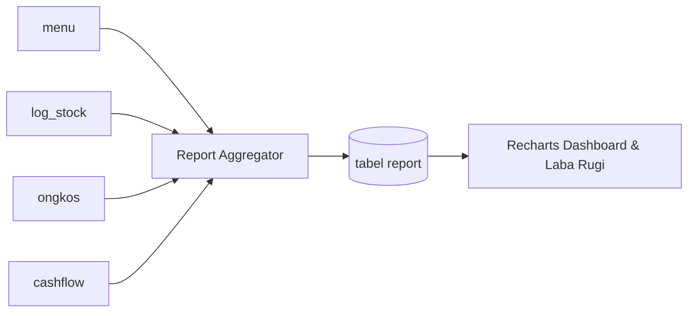

# Domain — Laporan & Akuntansi

Laporan keuangan (`Frontend/src/pages/report.tsx`) adalah lapisan agregasi bisnis yang menggabungkan data dari transaksi `menu`, mutasi stok `log_stock`, ongkos mekanik `ongkos`, dan pergerakan kas `cashflow`.

---

## 1. Sumber Perhitungan
* **Omzet Toko:** `SUM(log_stock.price_1 * log_stock.qty)` untuk penjualan barang non-minuman.
* **Omzet Minuman:** Omzet barang dengan kategori `minuman` atau jenis menu mengandung kata `minuman`.
* **Omzet Servis:** Omzet jasa dari transaksi bertipe `Servis Motor` / `Service`.
* **Laba Penjualan:** `(price_1 * qty) - (price_2 * qty)` untuk penjualan barang.
* **Laba Service:** Selisih harga jual jasa dengan HPP/komisi mekanik terkait.
* **Hutang:** Sisa kewajiban pembelian supplier (`total - dibayar`) pada transaksi tipe `pembelian` berstatus `belum`.
* **Piutang:** Sisa tagihan pelanggan (`total - dibayar`) pada transaksi `penjualan` dan `servis` berstatus `belum`.

---

## 2. Mesin Kalkulasi Ganda
Seperti disebut di [[Architecture]], agregasi laporan ada di dua tempat:

### A. Hook PocketBase (`Backend/pb_hooks/lib/atomic_ledger.js`)
* Fungsi `report(app, date)` menghitung agregasi secara realtime setiap kali ada mutasi di `menu`, `log_stock`, `cashflow`, atau `ongkos`.
* Hasilnya di-update ke baris `report` untuk tanggal kalender Jakarta (`Asia/Jakarta`, UTC+7).
* Menggunakan window function SQLite (`SUM(...) OVER ()`) untuk menghitung running balance dan snapshot.

### B. Laravel Service (`Backend/app/Services/ReportService.php`)
* `ReportService::recalculateDaily($dateString)` menghitung ulang laporan dari awal (backfill / repair).
* Dipicu oleh:
  * Tombol "Hitung Ulang Laporan" di UI → `POST /api/reports/recalculate`.
  * Command scheduler malam hari.
* Menghitung ulang `omset`, `laba`, `hutang`, `piutang`, `operasional`, `pemasukan_lain`, dan `pengeluaran_lain`.

### C. Risiko Drift
Setiap perubahan formula bisnis **wajib diterapkan pada kedua sisi** (JS hook dan PHP service). Perbedaan implementasi akan membuat laporan realtime PocketBase berbeda dengan laporan hasil rekalkulasi Laravel.

---

## 3. Tanggal Bisnis (`businessDate`)
* Aplikasi menggunakan zona waktu **Asia/Jakarta (UTC+7)** sebagai batas hari bisnis, bukan UTC.
* Perhitungan batas awal (`00:00:00.000`) dan akhir (`23:59:59.999`) dikonversi eksplisit ke UTC saat query SQLite.
* Fungsi di frontend: `businessDate()` dan `businessDateBoundary()` di `src/lib/cashflow.ts`.

---

## 4. Cron & Command Operasional

| Command | Jadwal | Fungsi |
| :--- | :--- | :--- |
| `report:create-daily` | Setiap hari 00:01 | Membuat record `report` kosong untuk tanggal berjalan jika belum ada. |
| `report:cleanup-holiday` | Setiap hari 00:00 | Menghapus record `report` kemarin yang memiliki total omzet nol (hari libur / toko tutup). |
| `reconcile:transactions` | Manual / operasional | Memeriksa konsistensi data transaksi dan ledger. |

Konfigurasi jadwal: `Backend/routes/console.php`.

---

## 5. Visualisasi UI
* Dashboard Recharts menampilkan tren omzet, komposisi laba, dan perbandingan periode.
* Filter periode: harian, bulanan, tahunan.
* Akses halaman dibatasi Level 1–6. Level 10 (kasir terbatas) diblokir dari halaman laporan.

---

Terkait: [[Domain - Keuangan & Cashflow]], [[Engine - Atomic Ledger & Idempotensi]], [[Domain - User & Hak Akses]]
