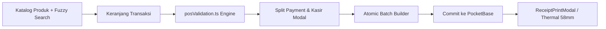

# Domain — POS & Kasir

Halaman kasir utama (`Frontend/src/pages/pos.tsx`) mengelola siklus transaksi toko suku cadang dan bengkel motor secara terpadu.

---

## 1. Fitur Utama Kasir
1. **Pencarian Produk Cepat:**
   * Barcode scanner otomatis via SKU input.
   * Fuzzy Search berbasis library Fuse.js untuk menangani salah ketik nama suku cadang.
   * Filter instan kategori produk, merk, dan status ketersediaan stok di toko.
2. **Multi-Tier Price Selection:**
   * Otomatis mengaplikasikan harga grosir (`sell_1` s/d `sell_6`) berdasarkan kuantum barang yang dibeli (`min_1` s/d `min_3`).
   * Kasir dapat melakukan penyesuaian diskon manual per item atau diskon global pada nota.
3. **Servis Motor & Alokasi Mekanik (`MechanicSection.tsx`):**
   * Transaksi tipe "Servis Motor" mewajibkan pengisian minimal 1 mekanik.
   * Nilai total ongkos kerja dibagi rata atau dialokasikan per porsi kepada mekanik yang bertugas.
   * Menghasilkan record otomatis ke tabel `ongkos` untuk perhitungan komisi servis harian.
4. **Split Payment Multi-Rekening:**
   * Pelanggan dapat membayar dengan kombinasi tunai (kas laci) dan transfer bank (BCA/Mandiri/QRIS) dalam 1 transaksi.
   * Kasir dapat menandai transaksi sebagai "Tempo" (belum lunas), yang akan otomatis mencatat piutang ke tabel `bon`.
5. **Autosave Draft 24 Jam (`posDraft.ts`):**
   * State keranjang kasir otomatis tersimpan di `localStorage` (`prima_pos_draft`).
   * Draft otomatis kadaluwarsa dan diabaikan setelah 24 jam.
   * Jika ada transaksi yang sedang pending pemeriksaan receipt (`prima_atomic_pending`), draft dikunci sementara agar tidak terjadi double order.
6. **Cetak Struk Thermal (`ReceiptPrintModal.tsx`):**
   * Output format printer thermal 58mm.
   * Mendukung pencetakan via antarmuka browser (`react-to-print`) dan protokol raw printing Android (`RawBT`).
7. **Pelunasan Cepat (`QuickSettleModal.tsx`):**
   * Modal pelunasan sisa piutang nota lama tanpa harus membuka kembali keranjang belanja.
   * Menghitung sisa tagihan berjalan (`settlementRemaining`) dan memperbarui status nota menjadi `lunas`.

---

## 2. Struktur Data Keranjang POS (`src/types/pos.ts`)
* `CartItem`:
  * `product`: Objek produk referensi.
  * `qty`: Jumlah unit barang yang dibeli.
  * `priceTier`: Tier harga yang aktif (`sell_1` - `sell_6`).
  * `customPrice`: Harga kustom jika kasir melakukan penyesuaian nominal.
  * `discount`: Nilai potongan per unit.
* `PaymentLine`:
  * `accountId`: ID dropdown akun kas/bank tujuan pembayaran.
  * `amount`: Nominal rupiah yang disetor ke akun tersebut.
* `MechanicAllocation`:
  * `mechanicId`: ID dropdown person mekanik.
  * `share`: Nominal rupiah komisi porsi kerja mekanik bersangkutan.

---

## 3. Aturan Validasi Form Checkout (`posValidation.ts`)
Fungsi `validateCheckout()` mengevaluasi form sebelum batch dibuat:
1. **Keranjang:** Dilarang kosong kecuali untuk transaksi jasa servis murni.
2. **Servis:** Wajib ada mekanik dengan ongkos > 0, dan catatan wajib memuat tipe motor.
3. **Pembayaran:** Setiap baris pembayaran yang memiliki nominal > 0 wajib memilih akun kas; akun kas yang dipilih wajib memiliki nominal > 0.
4. **Pesanan Online:** Wajib mengisi nama marketplace di catatan; admin fee dilarang bernilai negatif.
5. **Pembelian Tempo:** Wajib mengisi nomor nota supplier dan tanggal jatuh tempo (`tempoDate`).
6. **Auto Tab Switching:** Jika validasi gagal, modal checkout otomatis beralih ke tab form yang bersangkutan (`items`, `payment`, atau `notes`).

---

Terkait: [[Engine - Atomic Ledger & Idempotensi]], [[Domain - Inventaris & Produk]], [[Domain - Keuangan & Cashflow]]
