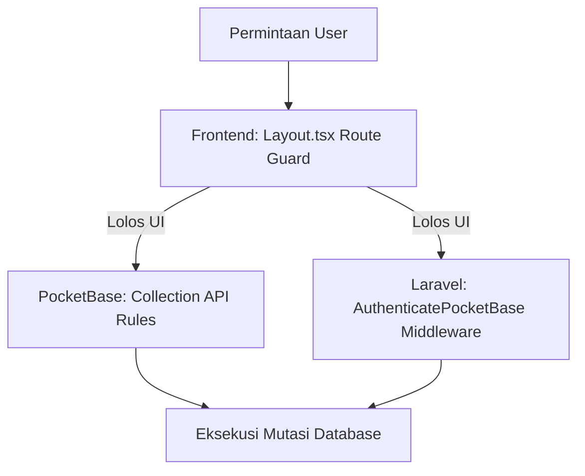

# Domain — User & Hak Akses

Model keamanan Prima Motor POS menerapkan **Defense-in-Depth** di 3 lapisan: Frontend Route Guard, Middleware Laravel, dan Rule Koleksi PocketBase.

---

## 1. Hirarki Level Akun
Tingkat kewenangan ditentukan oleh kolom numerik `level` pada tabel `user`:

| Level | Peran Utama | Akses Halaman | Kewenangan Khusus |
| :---: | :--- | :--- | :--- |
| **1** | Owner / Super Admin | Semua halaman (`/settings`, `/report`, dll) | Akses mutlak: kelola user, edit dropdown master, lihat slip gaji semua orang, override stok, bypass proteksi hapus. |
| **2–6** | Manager / Supervisor / Head Staff | Semua kecuali `/settings` | Boleh melihat laporan laba-rugi (`/report`), kelola kontak (`/person`), transaksi kasir, dan cashflow. |
| **7** | Staf | Tidak dibatasi di `layout.tsx` kecuali `/settings`, `/report` | Boleh `/person`. Dilarang `/report`. Akses halaman lain: ikuti guard API/PB. |
| **8–9** | Staf | Tidak dibatasi di `layout.tsx` kecuali `/settings`, `/report`, `/person` | Dilarang `/person`, `/report`, `/settings`. Batas penuh per fitur belum diverifikasi. |
| **10** | Kasir Terbatas / Magang | Hanya `/` (POS) dan `/akun` (Profil Pribadi) | Hanya melayani transaksi kasir. Diblokir dari seluruh data finansial dan master. |

---

## 2. Aturan Keamanan Penting (Security Invariants)

### A. Hak Operasional Akun Aktif
* Semua akun dengan status `active` (atau `Active`) **diizinkan menambah dan mengubah data transaksi operasional** tanpa batasan level (kebijakan `open_operational_entry`).
* Akun dengan status `inactive` / `suspended` ditolak seketika oleh middleware Laravel (HTTP 403) dan token dibatalkan oleh PocketBase.

### B. Privasi Penggajian (Salary Privacy)
* Setiap karyawan hanya boleh melihat slip gaji miliknya sendiri (`gaji.user = @request.auth.id`).
* Hanya akun **Level 1** yang diizinkan membaca, menambah, atau merekap slip gaji staf lain.
* Aturan ini ditegakkan di level database via PocketBase `viewRule` pada koleksi `gaji`.

### C. Whitelist Izin Hapus Akun Kas
* Menghapus transaksi kasir atau mutasi kasflow tidak otomatis diizinkan untuk semua staf.
* Akun kas/bank (`dropdown` tipe `akun_kas`) menyimpan whitelist di kolom `enum_1` (daftar username kasir) dan `visibilitas` (daftar level yang diizinkan).
* Hook `authorize()` pada `00_atomic_ledger.pb.js` menolak penghapusan transaksi jika username operator tidak ada di `enum_1` atau levelnya tidak tercantum di `visibilitas` akun kas bersangkutan.
* Level 1 otomatis lolos dari pemeriksaan whitelist ini.

### D. Anti-Tampering Level Akun
* Komponen `src/components/layout.tsx` memverifikasi kesesuaian nilai `user_level` antara `localStorage` dengan record di PocketBase:
  * Diperiksa setiap pergantian rute.
  * Diperiksa setiap interval 5 detik.
  * Diperiksa pada event browser `storage` (jika user mengubah value via devtools).
  * Jika ditemukan selisih, sistem memicu `forceLogout()` seketika.

---

## 3. Pengecekan Izin Hapus Asinkron (`DeleteAccess.tsx`)
* Tombol aksi hapus pada baris tabel tidak langsung dirender secara terbuka.
* Komponen `<DeleteAccess>` mengumpulkan ID record ke dalam antrean microtask dan mengirimnya ke `POST /api/permissions/delete`.
* Jika backend merespons `{ allowed: false }` atau jaringan gagal, tombol hapus disembunyikan (fail-closed).
* Ini mencegah user mengeklik tombol hapus pada data yang nantinya pasti gagal saat diproses.

---

Terkait: [[Database & Schema]], [[Domain - POS & Kasir]], [[Agent Rules & Best Practices]]
