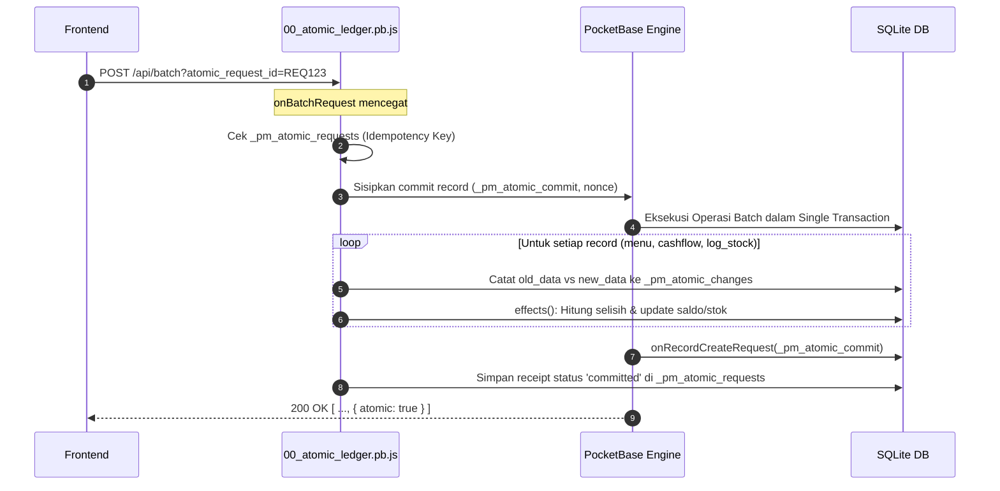
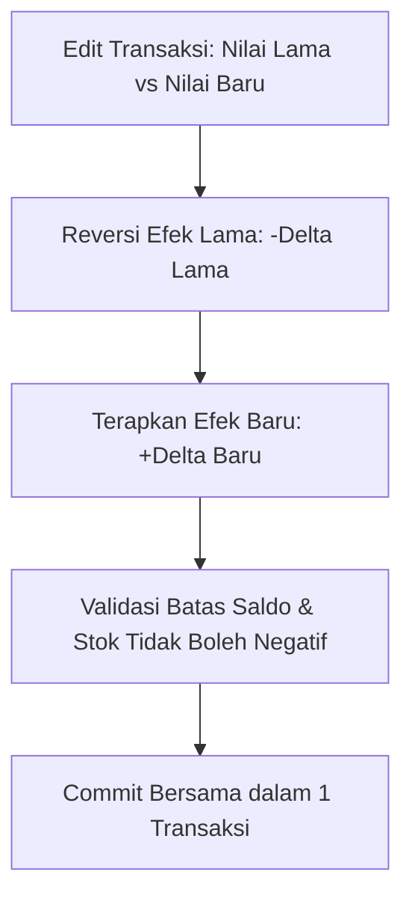

# Engine — Atomic Ledger & Idempotensi

Inti keandalan data finansial Prima Motor POS terletak pada arsitektur **Atomic Batch Ledger** dan **Receipt Idempotensi**. Seluruh mutasi uang dan stok dijamin konsisten dan atomik tanpa adanya saldo mengambang atau desinkronisasi stok.



---

## 1. Mekanisme Batch Interceptor (`00_atomic_ledger.pb.js`)

1. **Pencegatan Awal (`onBatchRequest`):**
   * Saat klien mengirim `POST /api/batch?atomic_request_id={id}`, hook memvalidasi ID request dan membuat key unik `{user_id}:{request_id}`.
   * Hook memeriksa apakah receipt sudah ada di tabel `_pm_atomic_requests`:
     * Jika status `committed` -> kembalikan respons lama (idempoten).
     * Jika status `cancelled` -> tolak transaksi dengan pesan error.
   * Generate token acak 24 karakter (`nonce`) dan simpan ke variabel batch.
   * Menyisipkan operasi sintetis di baris terakhir batch: `POST /api/collections/_pm_atomic_commit/records` membawa `nonce` tersebut.

2. **Eksekusi Mutasi Terpadu:**
   * Setiap mutasi tabel bisnis (`menu`, `cashflow`, `log_stock`, `ongkos`, `bon`) memicu hook `mutation()` di bawah transaksi database SQLite yang sama.
   * **Optimistic Locking (`_pm_expected` & `_pm_expected_stock`):**
     Sistem membandingkan snapshot field sebelum write. Jika data di server telah berubah oleh user lain saat form masih terbuka di layar klien, transaksi ditolak:
     `"Data transaksi berubah sejak form dibuka. Muat ulang sebelum menyimpan."`

3. **Komit Final & Kalkulasi Snapshot Backend:**
   * Saat request sintetis terakhir dieksekusi, hook `onRecordCreateRequest` untuk `_pm_atomic_commit` memverifikasi `nonce`.
   * Memanggil `finish()` untuk merekonsiliasi snapshot saldo/stok dan laporan harian:
     * `rebuildAccount(app, id, anchor)`: Menghitung mundur snapshot `saldo_awal` dan `saldo_akhir` riwayat `cashflow` via window function SQLite (`SUM(delta) OVER ()` dan `SUM(delta) OVER (ORDER BY created_at, id ROWS UNBOUNDED PRECEDING)`).
     * `rebuildStock(app, id)` / `anchorStock(app, id, balance)`: Menghitung mundur snapshot `stok_awal` dan `stok_akhir` riwayat `log_stock`.
     * Frontend tidak lagi menghitung atau mengirim field-field snapshot ini.
   * Menulis receipt permanen dengan status `committed` ke tabel `_pm_atomic_requests`.
   * Mengembalikan respons penutup `{ atomic: true }`.

---

## 2. Reverse-on-Edit & Reverse-on-Delete
Sistem tidak pernah mengizinkan penimpaan nilai baru secara langsung. Setiap edit atau hapus **wajib membalik efek lama terlebih dahulu**:



* **Cashflow Edit/Delete:**
  `cashDeltas(old)` dihitung lalu dikurangkan dari saldo dompet, baru kemudian `cashDeltas(new)` ditambahkan. Jika saldo akhir jatuh ke bawah 0 (`balance < -0.00001`), transaksi ditolak: `"Saldo akun tidak cukup untuk perubahan ini. Seluruh batch dibatalkan."`
* **Log Stock Edit/Delete:**
  Kuantitas fisik lama dibalik arahnya (jika dulu `out`, kini ditambah kembali ke stok; jika dulu `in`, dikurangi). Jika stok akhir `< 0`, transaksi dibatalkan.
* **Cascade Reversal:**
  Menghapus satu nota `menu` akan secara rekursif memicu penghapusan dan pembalikan seluruh anak transaksi (`log_stock`, `cashflow`, `ongkos`, `bon`, `gaji`) via fungsi `cascade()` dan `derived()`.

---

## 3. Penanganan Putus Jaringan & Pemulihan (`atomic_requests.js`)
Jika browser mengirim batch dan jaringan putus sebelum respons HTTP diterima:
1. Frontend mengunci layar dengan modal blocking `prima_atomic_pending`.
2. Frontend memanggil `POST /api/financial/requests/{id}/resolve`.
3. Di backend, fungsi `resolve()` mengambil **SQLite Write Lock** (`runInTransaction`) dan menjalankan:
   ```sql
   INSERT OR IGNORE INTO _pm_atomic_requests (id, response_json)
   VALUES (:key, '{"status": "cancelled"}')
   ```
4. **Hasilnya:**
   * Jika batch asli tadi ternyata **berhasil commit sebelum putus**, database sudah berisi `status: "committed"`. Statement `INSERT OR IGNORE` diabaikan, dan klien menerima konfirmasi sukses.
   * Jika batch asli **belum pernah sampai atau gagal**, receipt kini terkunci sebagai `cancelled`. Jika batch asli yang tertunda tiba-tiba masuk terlambat, batch tersebut akan ditolak dan tidak akan pernah menduplikasi transaksi.

---

## 4. Keunikan Engine JavaScript PocketBase (Goja Runtime)
PocketBase menjalankan hooks di atas engine **Goja** (JavaScript interpreter dalam bahasa Go). Terdapat beberapa keunikan kritis yang wajib dipahami developer:
1. **Type Mapping Float vs Int64:**
   Nilai integer murni di JS dipetakan menjadi Go `int64`. Ketika query agregasi SQLite mengembalikan nilai bertipe `REAL` (float), Goja akan crash saat melakukan unmarshaling ke model bertipe int.
   * **Solusi di kode:** Seluruh inisialisasi agregasi wajib disuntik dengan bilangan pecahan tidak bulat:
     `const result = new DynamicModel({ omset_toko: 0.5, laba: 0.5 });`
2. **Konteks Transaksi Terikat:**
   Dilarang memanggil objek global `$app` di dalam hook transaksi. Seluruh pembacaan dan penulisan wajib memakai instance `app` lokal yang disuplai oleh handler event (`e.app` atau `app.runInTransaction`).

---

Terkait: [[Architecture]], [[Database & Schema]], [[Domain - POS & Kasir]], [[Domain - Keuangan & Cashflow]]
