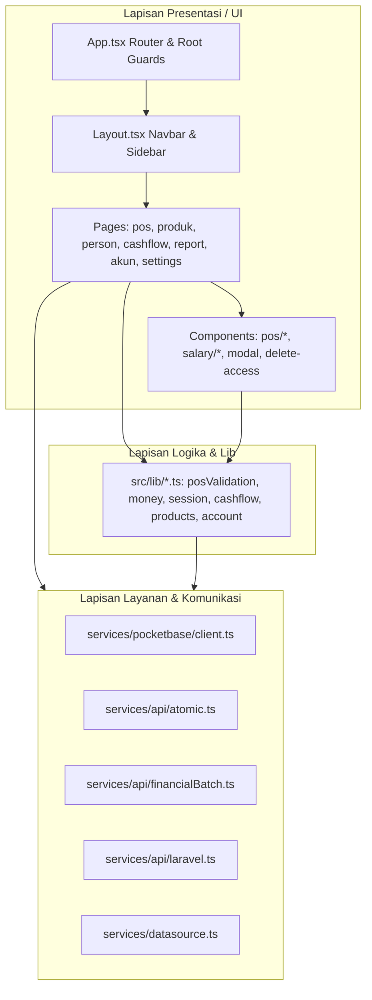

# Frontend Architecture

Aplikasi frontend (`Frontend/src`) dibangun menggunakan **React 19.2**, **React Router 7**, **Vite 8**, dan **TypeScript**, dioptimalkan untuk responsivitas kasir bengkel dengan layar sentuh, tablet, dan desktop.

---

## 1. Alur Bootstrapping & Lifecycle (`App.tsx`)
1. **Pemeriksaan Sesi & Validasi Background:**
   * Memeriksa `pb.authStore.isValid`.
   * Menjalankan interval 1 detik untuk `checkSessionExpiry()` dan 5 menit untuk `validateSession()`.
   * Mendengarkan event `focus` dan `visibilitychange` jendela browser untuk memvalidasi token saat kasir kembali ke tab aplikasi.
2. **Auto-Update & Anti-Staleness:**
   * Memeriksa file `/version.json` secara berkala. Jika server merilis versi bundle baru, aplikasi otomatis memuat ulang diri (`window.location.reload()`) agar browser tidak menjalankan chunk usang.
3. **Modal Pemblokir Mutasi Gantung (`atomicPending`):**
   * Jika ada transaksi yang sedang pending pemeriksaan status (`hasPendingAtomic()`), UI langsung menampilkan overlay modal pemblokir full-screen (`z-[9999]`). Kasir dilarang membuat transaksi baru sebelum status diperiksa via `retrySync()`.

---

## 2. Lapisan Utilitas (`src/lib/*.ts`)

| Modul | Tanggung Jawab Utama | Fungsi Kunci |
| :--- | :--- | :--- |
| `posValidation.ts` | Validasi menyeluruh form checkout kasir sebelum batch dikirim | `validateCheckout()`, `FIELD_TAB` |
| `money.ts` | Format representasi mata uang Rupiah (`id-ID`) yang toleran terhadap nilai null/string | `formatRupiah()`, `formatNumberID()`, `formatAmount()` |
| `products.ts` | Normalisasi barcode SKU, validasi harga bertingkat, dan mutasi stok fisik | `normalizeProductCode()`, `stockAdjustment()`, `isProductCodeConflict()` |
| `cashflow.ts` | Penguncian kalender tanggal bisnis Asia/Jakarta dan kalkulasi batas saldo kas | `businessDate()`, `businessDateBoundary()`, `editableBalance()` |
| `session.ts` | Pengelolaan kedaluwarsa token, pembersihan aman auth, dan injeksi interceptor | `endSession()`, `checkSessionExpiry()`, `installSessionGuard()` |
| `financialPatch.ts` | Sanitasi payload update agar tidak menimpa saldo berjalan yang telah berubah di server | `financialPatch()` |
| `posDraft.ts` | Autosave dan pemulihan keranjang kasir dari `localStorage` dengan TTL 24 jam | `readPosDraft()`, `POS_DRAFT_KEY` |
| `posTransactions.ts` | Klasifikasi transaksi, alokasi sisa pelunasan piutang, dan pencocokan log stok | `isIncomeTransaction()`, `settlementRemaining()` |
| `account.ts` | Perhitungan rincian slip gaji staf dan rekap akumulasi pinjaman bon | `salaryDetails()`, `loanSummary()` |
| `ids.ts` | Generator string ID 15 karakter berbasis `crypto.getRandomValues` (aman untuk LAN non-HTTPS) | `createRecordId()` |
| `transactionError.ts`| Traversal pesan kesalahan rekursif dari respons PocketBase/Laravel ke teks ramah UI | `transactionError()` |

---

## 3. Komunikasi Data & Service Layer

### A. Dynamic Datasource Resolution (`services/datasource.ts`)
* Pada tahap build, Vite menyuntikkan konstanta `__DATASOURCE__` dari file `datasource`.
* Saat runtime di browser:
  * Jika diakses dari `localhost` atau `127.0.0.1` -> otomatis mengarah ke port lokal Docker (`PB_HOST_PORT: 8090`, `API_HOST_PORT: 8000`).
  * Jika diakses dari nama domain eksternal -> otomatis menggunakan URL HTTPS publik (`PB_PUBLIC_URL`, `API_PUBLIC_URL`).

### B. Financial Batch Service (`services/api/financialBatch.ts`)
* Membungkus panggilan `pb.createBatch()`.
* Mengalokasikan ID 15 karakter di sisi klien sebelum request dikirim via `createRecordId()`.
* Mengunci transaksi ke `localStorage` (`prima_atomic_pending:<userId>`).
* Menyertakan payload verifikasi integritas data (`atomic_expected` dan `expected_stock`).

### C. Outbox Sync Laravel (`services/api/laravel.ts`)
* Panggilan API Laravel otomatis menyuntikkan header `Authorization: Bearer <pb.authStore.token>`.
* `syncLaravelEvents()` mengelola antrean pengiriman webhook mutasi ke Laravel secara asinkron tanpa memblokir kasir.

---

Terkait: [[Architecture]], [[Domain - POS & Kasir]], [[Engine - Atomic Ledger & Idempotensi]]
