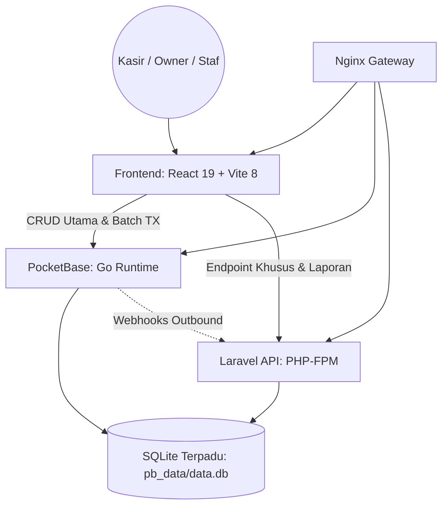

# Prima Motor POS — Master Knowledge Hub

Sistem ERP & POS bengkel motor modern berbasis **React (Vite)**, **PocketBase**, **Laravel (PHP 8.3)**, dan **Nginx**, terorkestrasi via **Docker Compose**.

---

## 🗺️ Peta Navigasi Vault

### 1. Fondasi & Konfigurasi
* [[Architecture]] — Topologi container, shared SQLite, dual execution engine, gateway Nginx.
* [[Data Source]] — Sumber kebenaran koneksi, port Docker, tunnel Cloudflare, dan env vars.
* [[Database & Schema]] — Skema lengkap tabel SQLite, relasi, snapshot field, dan tabel internal atomic ledger.
* [[API Surface & Integrasi]] — Daftar endpoint Laravel, PocketBase, Webhook, dan middleware.

### 2. Modul Bisnis (Domain)
* [[Domain - POS & Kasir]] — Keranjang kasir, multi-tier pricing, split payment, mekanik, cetak struk thermal, dan draft recovery.
* [[Domain - Inventaris & Produk]] — Manajemen katalog, stok multi-gudang (`stok_1`-`stok_3`), `log_stock`, SKU sanitasi, dan `stok_override`.
* [[Domain - Keuangan & Cashflow]] — Buku kas/bank, mutasi in/out/transfer, bon pinjaman karyawan, dan slip gaji personal.
* [[Domain - Laporan & Akuntansi]] — Agregasi omzet, HPP, margin laba-rugi, cron daily/holiday, dan job rekalkulasi.
* [[Domain - User & Hak Akses]] — Hirarki level akun (Level 1–10), permission guard, proteksi privasi gaji, dan session lifecycle.

### 3. Engine Inti & Mekanisme Transaksi
* [[Engine - Atomic Ledger & Idempotensi]] — Batch commit PocketBase, hook `00_atomic_ledger`, reverse-on-edit/delete, idempotensi receipt, dan dual-engine PHP/JS.
* [[Frontend Architecture]] — Struktur komponen React, router, lazy loading, utilitas `lib/`, service layer, dan handling offline/sync.

### 4. Operasional, Pengujian & Aturan Agent
* [[Testing & Quality Assurance]] — Frontend tests (14 suites), Backend PHPUnit (10 suites), Python integration harness, dan scale testing.
* [[Agent Rules & Best Practices]] — Aturan mutlak `AGENTS.md`, pantangan modifikasi data operasional, dan checklist migrasi.
* [[Mindmap - Sistem Prima Motor.canvas]] — Kanvas visual interaktif (Obsidian Canvas) menghubungkan seluruh subsistem.
